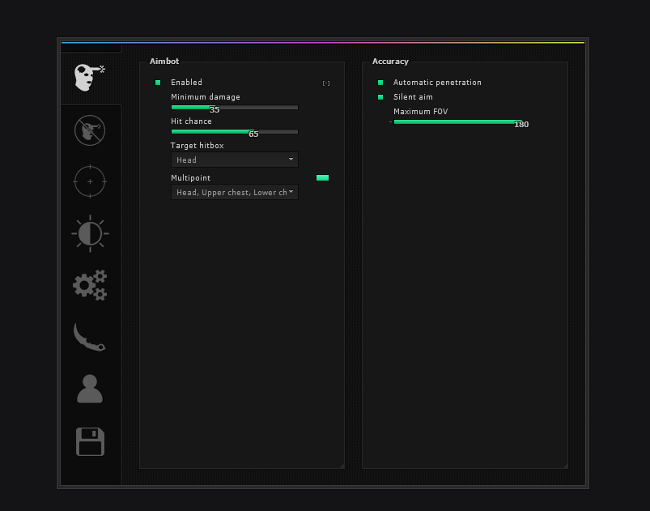
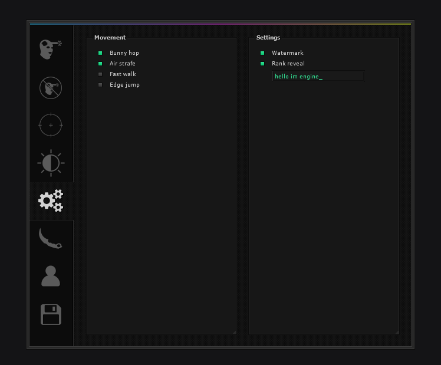
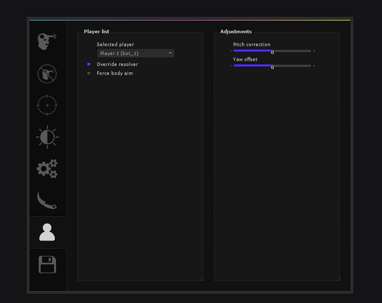

# Gamesense (Skeet) GUI Standalone C++20 Engine
No i am not a bot this is real, just made with AI

A self-contained, standalone C++20 desktop implementation of the proprietary **Gamesense ("Skeet")** GUI and 2D rendering pipeline, completely severed from CS:GO, engine hooks, and memory manipulation.

---

## Preview

<p align="center">
  <br>
  <em>Rage tab featuring checkboxes, numeric sliders, comboboxes, and multi-select dropdowns</em>
</p>

<p align="center">
  <br>
  <em>Misc tab showcasing native GDI font rasterization, movement toggles, and interactive text inputs</em>
</p>

<p align="center">
  <br>
  <em>Player list tab displaying column grouping, entity selection, and offset controls</em>
</p>

---

## Overview

Unlike many contemporary UI projects in the game modification space that rely on Dear ImGui, the original Gamesense client implemented a bespoke, custom 2D rendering framework and immediate/retained-hybrid widget tree.

This project isolates that GUI architecture into an independent desktop application running on native Direct3D 9Ex.

### Key Architecture & Subsystems

* **Direct3D 9Ex Command Queue (`RendererBackend` & `RendererContainer`)**:
  * Implements a double-buffered batch command queue (`RenderQueue`) recording primitive vertices, textured quads, gradient fills, and scissors before flushing to the GPU.
  * Uses `Direct3DCreate9Ex` and `IDirect3DDevice9Ex` to ensure hardware acceleration and full compatibility with modern Windows 10/11 GPU drivers (including NVIDIA RTX series).
* **GDI-to-D3D9 Font Rasterizer (`FontRuntime` & `FontBackend`)**:
  * Employs native Win32 GDI rasterization (`CreateDIBSection`, `GetCharABCWidthsW`) to generate dynamic texture atlases with custom kerning, text metrics, and 1px borders.
  * Implements the 7 native font recipes: Verdana, Calibri, Segoe UI Symbol, Small Fonts, and Malgun Gothic.
* **Embedded Tab Icon Atlas (`menu_tab_atlas.inc`)**:
  * Directly decodes the original 384x48 pixel resource containing the 8 iconic navigation icons (Rage, Anti-Aim, Legit, Visuals, Misc, Skins, Players, and Config).
* **Complete Custom Widget Tree**:
  * **Checkbox**: Binary toggle with state linkage to child widgets.
  * **Slider**: Smooth mouse-dragging with customizable numeric/unit ranges (`%`, `px`, `ms`, etc.).
  * **ComboBox**: Drop-down selection with custom scrollbar, hover detection, and clipping.
  * **MultiSelect**: Multi-option bitmask selector with formatted active summary text.
  * **ColorPicker**: Interactive HSV gradient picker, saturation square, alpha bar, and hex copy/paste.
  * **Textbox**: Text input field with cursor tracking and caret rendering.
  * **HotkeyWidget**: Keybind assigner with mode selection (Always, Hold, Toggle).
  * **Button**: Push buttons with pressed/hover states and callback hooks.
* **Window Mechanics**:
  * Window drag handling anywhere on the menu frame.
  * Bottom-right corner resize grip.
  * Smooth 150ms opacity transition animations (fade-in / fade-out).
  * Toggle menu visibility via the **`INSERT`** key.

---

## Directory Structure

```
skeet_menu_standalone/
├── assets/                     # Preview screenshots & resources
├── CMakeLists.txt              # Standard CMake build configuration
├── build.ps1                   # Automated PowerShell build script
├── run.cmd                     # One-click launcher
├── .gitignore                  # Git ignore rules
├── include/
│   └── skeet/
│       ├── core.hpp            # Geometric primitives & basic types
│       ├── gui_layout.hpp      # Layout calculation & grid placement
│       ├── widgets.hpp         # Base Widget class & basic controls
│       ├── menu_tree.hpp       # Categories & Tabs hierarchy
│       ├── menu_window.hpp     # MenuWindow controller & input dispatch
│       ├── render_queue.hpp    # 2D Draw command buffer
│       ├── font_cache.hpp      # Font link & glyph caching
│       ├── font_metrics.hpp    # Font dimension measurement
│       ├── text_metrics.hpp    # Text string width/height measurement
│       ├── scrollbar_render.hpp# Scrollbar geometry & interaction
│       ├── button.hpp          # Push button control
│       ├── combobox.hpp        # Drop-down combo selector
│       ├── color_picker.hpp    # HSV Color picker widget
│       ├── multiselect.hpp     # Multi-choice bitmask selector
│       ├── textbox.hpp         # Text input box
│       ├── hotkey_widget.hpp   # Keybind selector
│       ├── menu/
│       │   ├── window_events.hpp   # Win32 input message decoders
│       │   ├── window_lifetime.hpp # Callback storage & initialization
│       │   └── window_render.hpp   # Frame decoration & RGB bar
│       └── render/
│           ├── backend.hpp         # Direct3D 9 vertex & draw backend
│           ├── backend_container.hpp# Frame synchronization & font owner
│           ├── font_runtime.hpp    # GDI rasterizer & texture generator
│           ├── menu_background.hpp # Checkered pattern generator
│           └── menu_window_assets.hpp# Atlas texture loader
└── src/
    ├── main.cpp                # Win32 entry point & Direct3D9Ex loop
    ├── gui.cpp / gui_layout.cpp# Layout logic & tab switching
    ├── widgets.cpp             # Widget implementations
    ├── button.cpp / combobox.cpp / color_picker.cpp / ...
    ├── menu_tree.cpp           # Tab & Category layout reflow
    ├── menu_render.cpp         # UI element drawing routines
    ├── render_queue.cpp        # Command serialization
    ├── font_cache.cpp / font_metrics.cpp / text_metrics.cpp
    ├── menu/                   # Window events, layout, rendering
    └── render/                 # D3D9 device objects & text rendering
```

---

## Requirements

* **Operating System**: Windows 10 or Windows 11 (x86 / x64 compatible).
* **Toolchain**: Microsoft Visual Studio 2022+ with C++20 support.
* **Build System**: CMake 3.20+.
* **Graphics API**: Direct3D 9 (included natively in Windows).

---

## Building

### Quick Build (PowerShell)

```powershell
.\build.ps1
```

### Manual Build (CMake)

```cmd
cmake -B build -A Win32
cmake --build build --config Release
```

The compiled binary will be placed at:
`build\Release\skeet_menu_standalone.exe`

---

## Controls

| Key / Action | Function |
|---|---|
| **`INSERT`** | Toggle menu visibility (smooth fade-in / fade-out) |
| **Left Click + Drag (Frame)** | Move menu window around desktop |
| **Left Click + Drag (Bottom-Right)** | Resize menu window |
| **Left Click (Tab Icon)** | Switch between active tabs |
| **Left Click (Controls)** | Toggle checkboxes, select dropdowns, drag sliders |

---

## Disclaimer

This project is created strictly for **educational, historical, and software reverse-engineering research purposes**. It contains no game cheats, hooks, memory injectors, network bypasses, or anti-cheat tampering routines.
